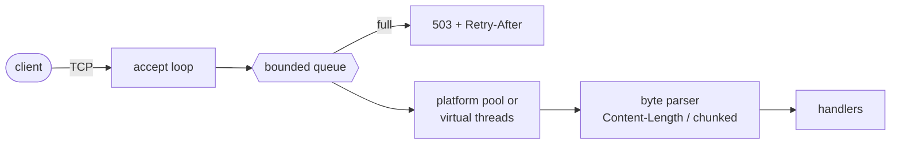
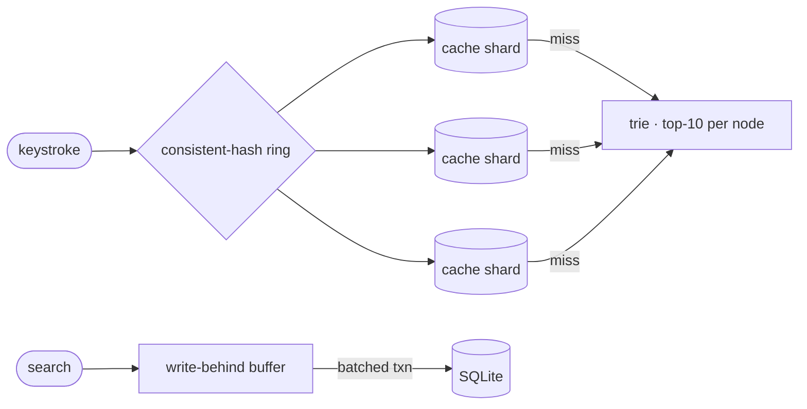
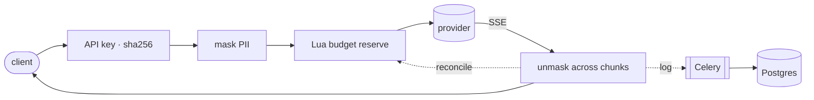

<h1 align="center">Swarnika Somvanshi</h1>

  <b>Backend engineer in the making.</b> I build systems from the protocol up, then measure them and fix what breaks. 
  Scaler School of Technology · BITS Pilani (CS, 2028) · Bengaluru

  
  
  

  

☝️ Not a mockup. Every Monday, CI compiles my <a href="https://github.com/swarnika-cmd/HTTP-1.1-Server">HTTP/1.1 server</a>, starts it, runs that <code>curl</code>, and re-renders this card from the real response.

## 📊 Numbers, not adjectives

Rendered from the benchmark results committed in each repo (`bench/results/`). Apple M4 Pro, Docker, wrk and k6. Local numbers for comparing designs, not production capacity.

## 🧱 What I built

| | Project | The interesting part |
|:-:|---|---|
| ⚡ | **[HTTP/1.1 Server](https://github.com/swarnika-cmd/HTTP-1.1-Server)** Java 21 · raw sockets · 47 tests | A bounded worker pool with 503 load shedding vs virtual threads: keep-alive connections pin platform threads, so virtual threads cut p99 by 12× |
| 🔎 | **[Search Typeahead](https://github.com/swarnika-cmd/SearchTypeahead)** TypeScript · SQLite · 67 tests | Precomputed top-K at every trie node makes lookups O(prefix length); the cost is memory, measured at 4.4 GB for 1M terms |
| 🛡️ | **[ShieldWall Gateway](https://github.com/swarnika-cmd/ShieldWall-Gateway)** FastAPI · Postgres · Redis · 88 tests | PII masked before it leaves, restored mid-stream across SSE chunks; budgets reserved atomically in a Redis Lua script |
| 🧠 | **[Smarana](https://github.com/swarnika-cmd/Smarana-PrivacyFirstBrain)** Chrome MV3 · FastAPI · pgvector | On-device embeddings and AES-256-GCM, with hybrid search fused by Reciprocal Rank Fusion |

<b>🔬 Architecture and the bugs I fixed (click to expand)</b>

 

**⚡ HTTP/1.1 Server**

Fixed with a failing raw-socket test first: a lowercase `content-length` desynced the connection, a UTF-8 body swallowed the next request, a negative `Content-Length` dropped the socket, and slow clients could pin every worker.

**🔎 Search Typeahead**

Fixed 10 bugs, including buffered searches lost at the hour boundary, `c++` and `c--` colliding in one trie node, and a half-committed batch on a failed flush. A brute-force property test caught a trailing-space bug.

**🛡️ ShieldWall Gateway**

Proved a check-then-act budget race with 50 concurrent requests (the budget fits 7; now exactly 7 succeed). Also fixed placeholder collisions that returned the wrong user's PII.

## 🌍 Merged

Mentored by Naomi Carrigan in the freeCodeCamp × NHCarrigan Summer 2026 cohort.

## 🧰 Toolbox

  

---

This page builds itself: <a href=".github/workflows/render-profile.yml"><code>render-profile.yml</code></a> compiles and curls my server, reads the benchmark files from my repos, and queries the GitHub API for merged PRs. Then <a href="scripts/render.py"><code>render.py</code></a> (standard-library Python) draws the cards. No third-party stat widgets, so nothing on this page can go down.
